# Zero UI Emergency Assistance System — Diagrams

> Complete architectural, flow, and interaction diagrams for the Zero UI Emergency Assistance System.

---

## 1. High-Level System Architecture

```mermaid
graph TB
    subgraph MOBILE["📱 Mobile Simulator (Frontend)"]
        SENSORS["🔧 SensorModule<br>sensors.js"]
        AUDIO["🎤 AudioModule<br>audio.js"]
        EMERGENCY["🆘 EmergencyModule<br>emergency.js"]
        APP["🧠 App State Machine<br>app.js"]
    end

    subgraph BACKEND["⚙️ FastAPI Backend"]
        API["🌐 REST API<br>main.py"]
        MODELS["📋 Pydantic Models<br>models.py"]
        DB["🗄️ Database Layer<br>database.py"]
        DIGIPIN["📍 DigiPIN Service<br>digipin_service.py"]
    end

    subgraph STORAGE["💾 Storage Layer"]
        SQLITE[("🗃️ SQLite DB<br>emergencies.db")]
        AUDIOFILES["🔊 Audio Files<br>data/audio/")]
    end

    subgraph DASHBOARD["📊 Monitoring Dashboard"]
        DASHAPP["📈 Dashboard App<br>app.js"]
        MAP["🗺️ Map Module<br>map.js"]
        LEAFLET["🌿 Leaflet.js<br>OpenStreetMap"]
    end

    subgraph EXTERNAL["🌍 External Services"]
        PYPI["📦 digipin PyPI Package<br>India Post Algorithm"]
        GMAPS["🗺️ Google Maps<br>Location Links"]
        OSM["🌐 OpenStreetMap<br>Map Tiles"]
    end

    APP --> SENSORS
    APP --> AUDIO
    APP --> EMERGENCY
    EMERGENCY -->|HTTP POST| API
    API --> MODELS
    API --> DB
    API --> DIGIPIN
    DIGIPIN --> PYPI
    DB --> SQLITE
    API --> AUDIOFILES
    DASHAPP -->|HTTP GET Poll| API
    MAP --> LEAFLET
    LEAFLET --> OSM
    EMERGENCY --> GMAPS
    DASHAPP --> MAP

    style MOBILE fill:#1a1a2e,stroke:#e74c3c,color:#fff
    style BACKEND fill:#1a1a2e,stroke:#6c5ce7,color:#fff
    style STORAGE fill:#1a1a2e,stroke:#f1c40f,color:#fff
    style DASHBOARD fill:#1a1a2e,stroke:#2eb45a,color:#fff
    style EXTERNAL fill:#1a1a2e,stroke:#5dade2,color:#fff
```

---

## 2. App State Machine (Mobile Simulator)

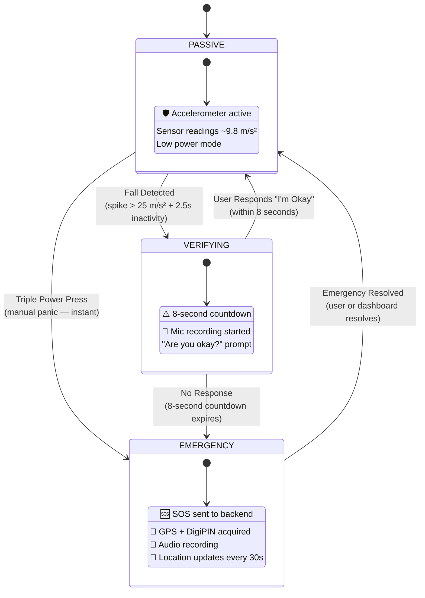

---

## 3. Emergency Trigger Flow — Fall Detection

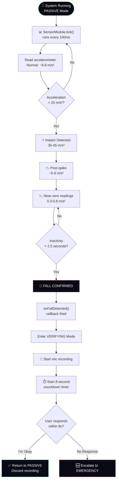

---

## 4. Emergency Activation Flow — Full Sequence

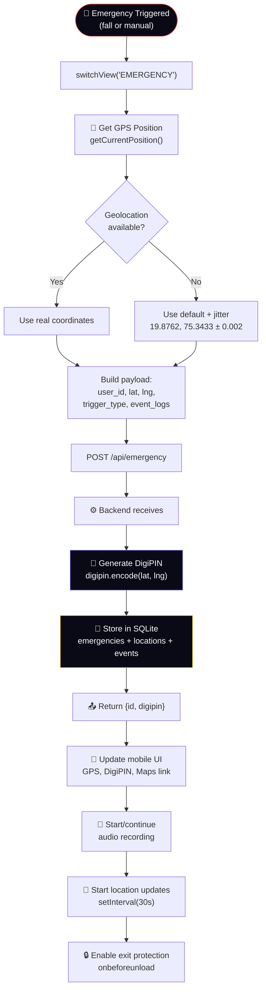

---

## 5. DigiPIN Generation Flow

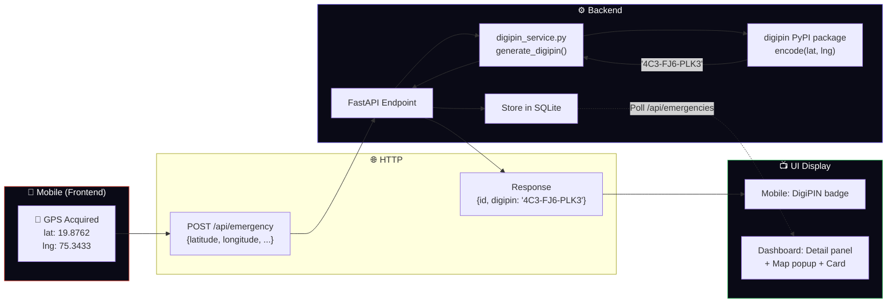

---

## 6. Live Location Update Cycle

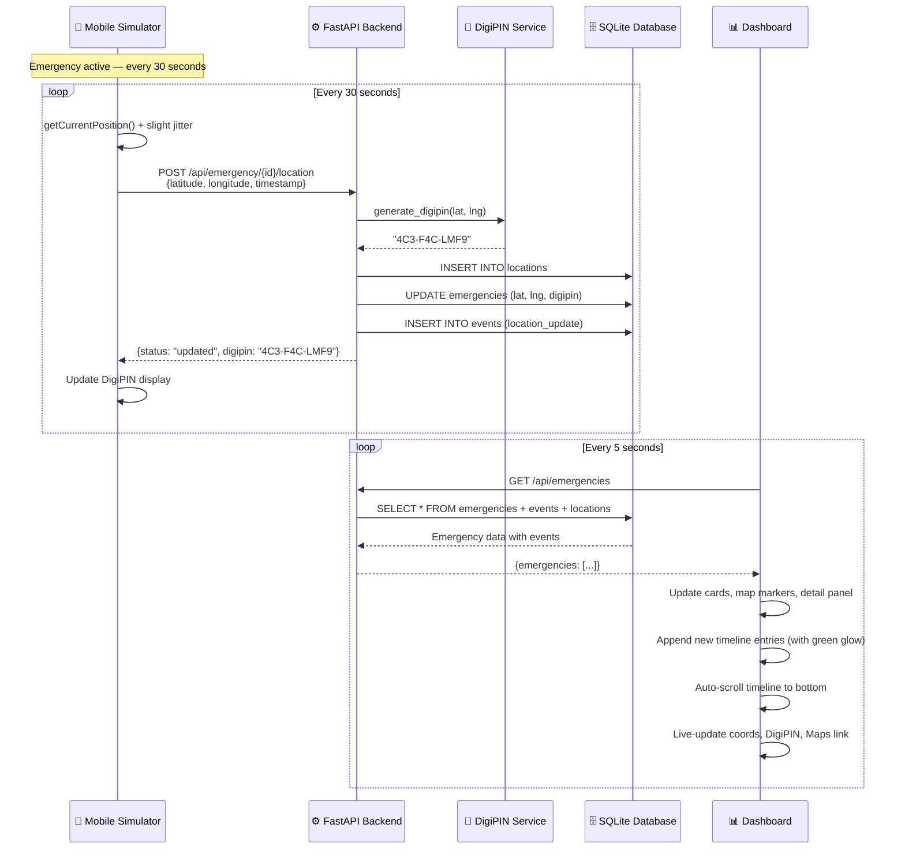

---

## 7. Audio Recording & Upload Flow

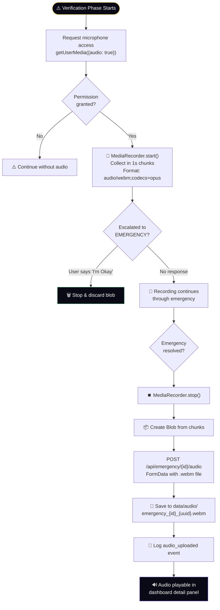

---

## 8. Dashboard Polling & Rendering Pipeline

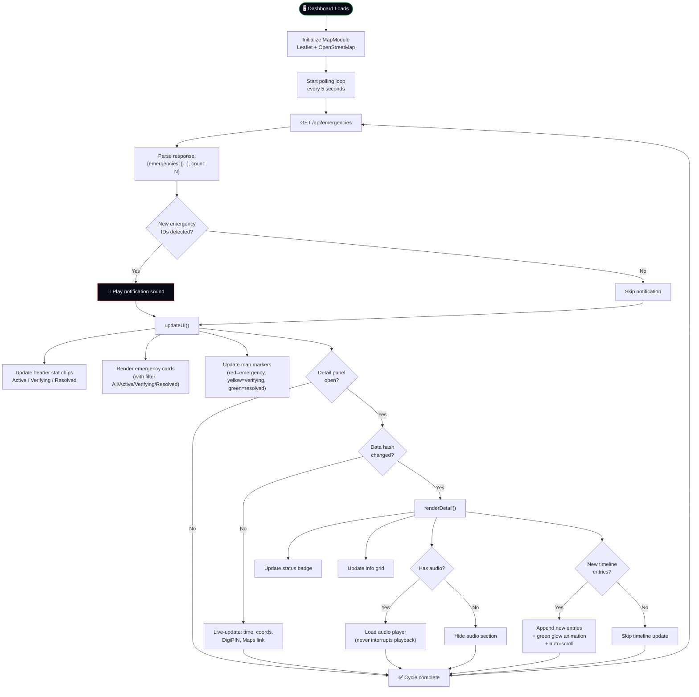

---

## 9. REST API Endpoint Map

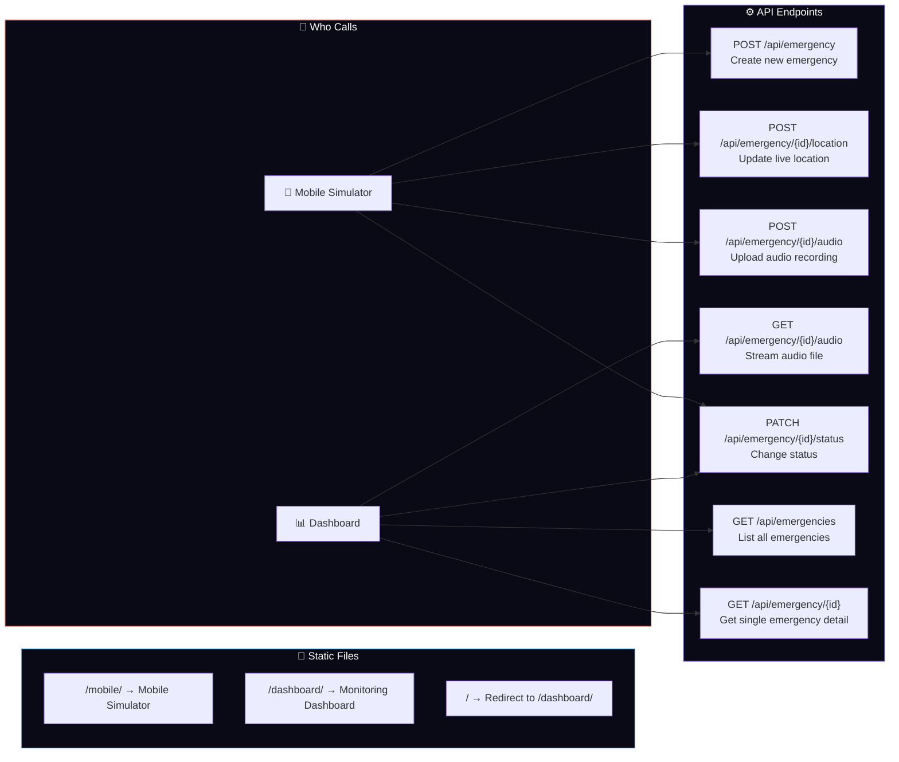

---

## 10. Database Entity Relationship Diagram

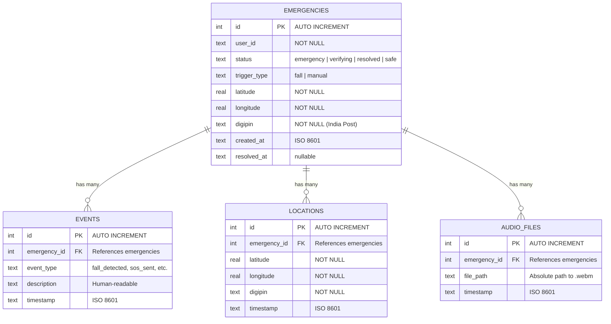

---

## 11. Emergency Resolution Flow

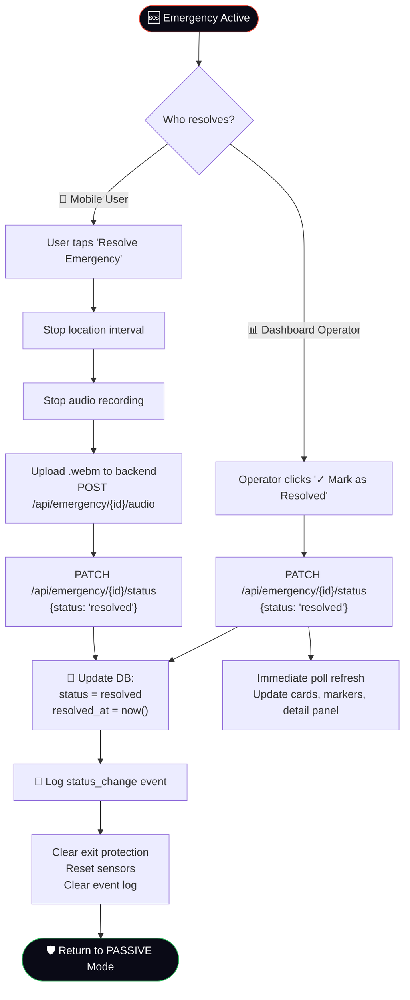

---

## 12. Project File Structure

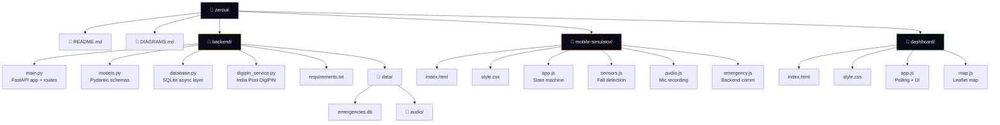

---

## 13. Complete End-to-End Sequence Diagram

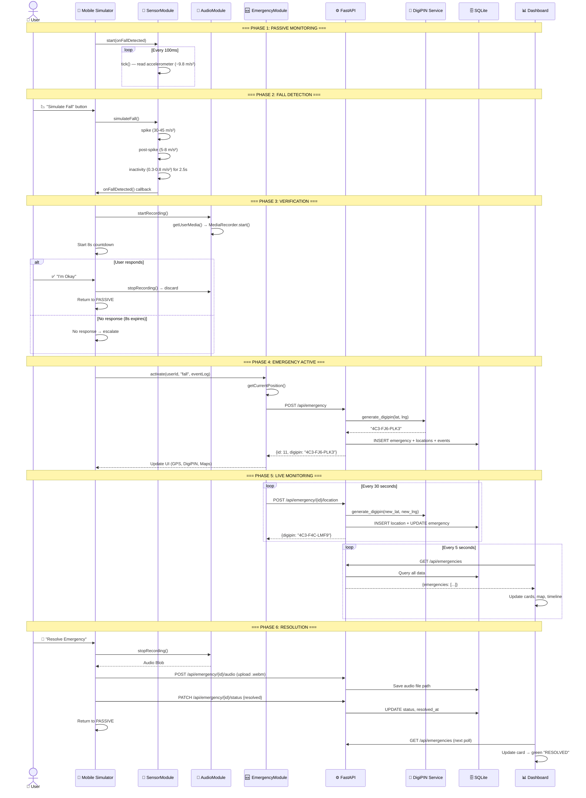

---

## 14. Technology Stack Overview

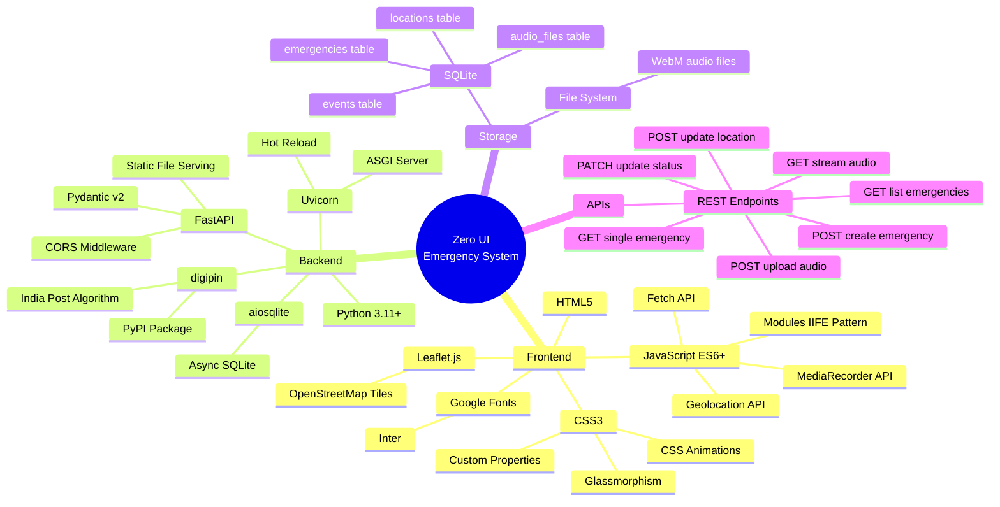
